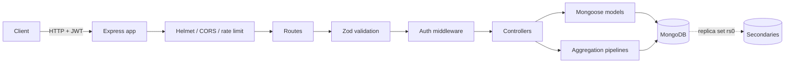

# MongoDB Final Project — E-Commerce Backend

[](https://github.com/sunnydev07/mongodb-final-project/actions/workflows/ci.yml)

A production-style REST API built with **Node.js, Express, Mongoose, and MongoDB**. The project demonstrates complete CRUD operations, query and index optimization, authentication and authorization, aggregation analytics, a three-node replica set, logical backups/restores, Docker deployment assets, and an automated Jest test suite.

> Final project for the MongoDB course requirement: *"Development of a backend application using MongoDB. Integration of CRUD operations. Designing queries and indexes for optimal performance. Implementation of replication and backup strategies. Deployment and testing of the application."*

---

## Table of contents

- [Assignment coverage](#assignment-coverage)
- [Features](#features)
- [Tech stack](#tech-stack)
- [Architecture](#architecture)
- [Project structure](#project-structure)
- [Quick start](#quick-start)
- [Environment variables](#environment-variables)
- [NPM scripts](#npm-scripts)
- [Seed data](#seed-data)
- [API overview](#api-overview)
- [Queries and indexes](#queries-and-indexes)
- [Replication](#replication)
- [Backup and restore](#backup-and-restore)
- [Testing](#testing)
- [Deployment](#deployment)
- [Documentation](#documentation)
- [Design notes and limitations](#design-notes-and-limitations)
- [License](#license)

---

## Assignment coverage

| Requirement | Implementation | Evidence |
| --- | --- | --- |
| Backend application using MongoDB | Express REST API with Mongoose ODM and four collections: `users`, `products`, `orders`, `reviews` | `src/`, `src/models/` |
| CRUD operations | Create/read/update/delete for users, products, orders, and reviews, with validation and role-based authorization | `src/controllers/` |
| Queries and indexes for optimal performance | Filtering, sorting, pagination, full-text search, geospatial `$near`, aggregation pipelines, compound/text/2D-sphere/multikey indexes, and an `explain()` benchmark | `src/models/`, `scripts/benchmark.js`, [docs/indexing.md](docs/indexing.md) |
| Replication | Three-node `rs0` replica set, automated start/init/stop scripts, data-propagation and failover verification, transaction support | `scripts/replica-set-*.{ps1,js}`, [docs/replication.md](docs/replication.md) |
| Backup strategy | Manifest-based logical backup and restore scripts, retention/offsite guidance, restore drill | `scripts/backup.js`, `scripts/restore.js`, [docs/backup.md](docs/backup.md) |
| Deployment | Multi-stage Dockerfile, production Docker Compose, replica-set Compose stack, health check, environment configuration | `deploy/`, [docs/deployment.md](docs/deployment.md) |
| Testing | 30 Jest + Supertest integration tests, all passing on both standalone MongoDB and the replica set | `tests/`, [docs/testing.md](docs/testing.md) |

---

## Features

- **JWT authentication** with bcrypt password hashing and `customer` / `seller` / `admin` roles.
- **Zod request validation** for bodies and query strings, with consistent error responses.
- **Product catalogue** with category/brand/tag/price/stock filters, five sort modes, full-text search, and `$near` geospatial search.
- **Order workflow** that validates stock, snapshots line items, decrements inventory atomically, and uses a transaction when the deployment is a replica set.
- **Reviews** with one review per user per product, verified-purchase detection, and automatic product rating/review-count recalculation via aggregation.
- **Analytics** using `$group`, `$bucket`, `$unwind`, and `$dateToString` for product and revenue dashboards.
- **Security middleware**: Helmet, CORS, compression, rate limiting, and centralized error handling.
- **Interactive OpenAPI docs** at `/api-docs` and raw JSON at `/api-docs.json`.

## Tech stack

| Layer | Technology |
| --- | --- |
| Runtime | Node.js 20.19+ (tested on Node 24) |
| Web framework | Express 5 |
| Database | MongoDB 7/8 (tested 8.2), Mongoose 9 |
| Authentication | `jsonwebtoken`, `bcryptjs` |
| Validation | Zod |
| Security / HTTP | Helmet, CORS, express-rate-limit, compression, morgan |
| API docs | swagger-ui-express |
| Tests | Jest, Supertest |
| Deployment | Docker, Docker Compose |

---

## Architecture



Request flow: **route → validation → authentication/authorization → controller → Mongoose → MongoDB**, with errors passed to a single error handler. See [docs/architecture.md](docs/architecture.md) for the data model and design decisions.

## Project structure

```text
mongodb-final-project/
├── src/
│   ├── app.js                  # Express app, security middleware, Swagger
│   ├── server.js               # HTTP server and graceful shutdown
│   ├── config/                 # env, Mongo connection, OpenAPI spec
│   ├── controllers/            # auth, user, product, order, review logic
│   ├── middleware/             # auth, validation, error handling, 404
│   ├── models/                 # User, Product, Order, Review schemas + indexes
│   ├── routes/                 # REST routes
│   ├── utils/                  # response envelope, pagination, order numbers
│   └── validators/             # Zod schemas
├── scripts/
│   ├── seed.js                 # 41 users, 500 products, 60 orders
│   ├── createIndexes.js        # syncIndexes + index report
│   ├── benchmark.js            # explain() index-vs-COLLSCAN benchmark
│   ├── backup.js / restore.js  # manifest-based JSON backup/restore
│   └── replica-set-*.{ps1,js}  # local 3-node replica set
├── tests/                      # 5 Jest suites, 30 integration tests
├── deploy/                     # Dockerfile + standalone/replica Compose files
├── docs/                       # architecture, API, indexing, replication, backup, deployment, testing
├── .github/workflows/ci.yml    # CI: Mongo service, lint, tests, seed, benchmark
├── .env.example
├── jest.config.js
└── package.json
```

---

## Quick start

### Prerequisites

- Node.js **20.19+**
- MongoDB **6+** running locally (or a Docker container)
- `mongosh` for replica-set commands (optional)

### 1. Clone and install

```bash
git clone https://github.com/sunnydev07/mongodb-final-project.git
cd mongodb-final-project
npm install
```

### 2. Configure environment

```bash
# macOS / Linux
cp .env.example .env

# Windows PowerShell
Copy-Item .env.example .env
```

Set a real `JWT_SECRET` in `.env`. The defaults work for local development.

### 3. Start MongoDB

```bash
# Local install
mongod --dbpath /path/to/data

# or Docker
docker run -d --name mongo-final -p 27017:27017 mongo:7
```

### 4. Seed and create indexes

```bash
npm run seed
npm run indexes
```

### 5. Run

```bash
npm run dev      # nodemon
# or
npm start
```

Open:

- API: <http://localhost:4000>
- Health: <http://localhost:4000/health>
- Swagger UI: <http://localhost:4000/api-docs>

### 6. Run the tests

```bash
npm test
```

Expected result: **5 suites, 30 tests passed**.

---

## Environment variables

| Variable | Default | Purpose |
| --- | --- | --- |
| `NODE_ENV` | `development` | Runtime mode; production enforces a non-default JWT secret |
| `PORT` | `4000` | HTTP port |
| `MONGODB_URI` | `mongodb://127.0.0.1:27017/mongo_final_project` | Application database |
| `MONGODB_TEST_URI` | `mongodb://127.0.0.1:27017/mongo_final_project_test` | Test database |
| `JWT_SECRET` | `change-me-in-production` | JWT signing key; **must** be changed in production |
| `JWT_EXPIRES_IN` | `7d` | Token lifetime |
| `CORS_ORIGIN` | `*` | Allowed origin(s), comma-separated |
| `RATE_LIMIT_WINDOW_MS` | `900000` | Rate-limit window (15 minutes) |
| `RATE_LIMIT_MAX` | `100` | Requests per window per IP |
| `MONGO_POOL_SIZE` | `10` | Mongoose connection pool size |
| `BACKUP_DIR` | `./backups` | Backup output directory |

---

## NPM scripts

| Command | Description |
| --- | --- |
| `npm start` | Start the API |
| `npm run dev` | Start with nodemon |
| `npm run seed` | Reset and seed users, products, and orders |
| `npm run indexes` | Sync all model indexes and print them |
| `npm run benchmark` | Compare indexed access with forced collection scans using `explain()` |
| `npm run backup` | Create a timestamped JSON backup with a manifest |
| `npm run restore` | Restore the latest backup (or pass a directory) |
| `npm run replica:start` | Start three local `mongod` nodes on ports 28017–28019 |
| `npm run replica:init` | Initiate the `rs0` replica set |
| `npm run replica:stop` | Stop the local replica-set nodes |
| `npm test` | Run all Jest integration tests |
| `npm run test:watch` | Run Jest in watch mode |
| `npm run lint` | Run ESLint |

Restore a specific backup:

```bash
npm run restore -- ./backups/backup-2026-10-29T08-02-21-698Z
```

---

## Seed data

`npm run seed` creates:

- **41 users** — 1 admin, 4 sellers, 36 customers
- **500 products** across 10 categories and 12 brands
- **60 orders** with mixed statuses and payment methods
- **158 reviews**, with product ratings and review counts recomputed from them

Demo credentials (local development only):

| Role | Email | Password |
| --- | --- | --- |
| Admin | `admin@example.com` | `AdminPass123!` |
| Seller | `customer10@example.com` | `Password123!` |
| Customer | `customer1@example.com` | `Password123!` |

---

## API overview

All responses use a consistent envelope:

```json
{ "success": true, "data": {}, "meta": {} }
```

Authentication uses `Authorization: Bearer <JWT>`.

| Method | Endpoint | Access | Description |
| --- | --- | --- | --- |
| `GET` | `/health` | Public | Health/uptime probe |
| `POST` | `/api/auth/register` | Public | Register customer/seller |
| `POST` | `/api/auth/login` | Public | Login and receive JWT |
| `GET` | `/api/auth/me` | Authenticated | Current profile |
| `GET` | `/api/products` | Public | Filter/sort/paginate/search products |
| `GET` | `/api/products/analytics/overview` | Public | Product aggregations |
| `GET` | `/api/products/:id` | Public | Product detail |
| `POST` | `/api/products` | Seller/Admin | Create product |
| `PATCH` | `/api/products/:id` | Owner/Admin | Update product |
| `DELETE` | `/api/products/:id` | Admin | Delete product |
| `GET` | `/api/products/:productId/reviews` | Public | List product reviews |
| `POST` | `/api/products/:productId/reviews` | Authenticated | Create review |
| `PATCH` | `/api/reviews/:id` | Owner/Admin | Update review |
| `DELETE` | `/api/reviews/:id` | Owner/Admin | Delete review |
| `GET` | `/api/orders` | Authenticated | List orders (customers see own) |
| `POST` | `/api/orders` | Authenticated | Create order, decrement stock |
| `GET` | `/api/orders/:id` | Owner/Admin | Order detail |
| `PATCH` | `/api/orders/:id/status` | Admin/Seller | Update status/payment |
| `DELETE` | `/api/orders/:id` | Admin | Delete order |
| `GET` | `/api/orders/analytics/overview` | Admin | Revenue analytics |
| `GET` | `/api/orders/customer/:id/summary` | Self/Admin | Customer lifetime summary |
| `GET` | `/api/users` | Admin | List users |
| `GET` | `/api/users/:id` | Authenticated | User profile |
| `PATCH` | `/api/users/:id` | Self/Admin | Update profile/password |
| `DELETE` | `/api/users/:id` | Admin | Delete user |

Full request/response examples: [docs/api.md](docs/api.md). Interactive docs: `/api-docs`.

### Example requests

```bash
# Login
curl -X POST http://localhost:4000/api/auth/login \
  -H "Content-Type: application/json" \
  -d '{"email":"admin@example.com","password":"AdminPass123!"}'

# Filter + sort products
curl "http://localhost:4000/api/products?category=Mobiles&minPrice=5000&maxPrice=50000&sort=price_desc&limit=5"

# Full-text search
curl "http://localhost:4000/api/products?search=Samsung&limit=5"

# Geospatial search (longitude, latitude, max metres)
curl "http://localhost:4000/api/products?near=77.5,11.5,10000&limit=5"

# Create an order (customer token required)
curl -X POST http://localhost:4000/api/orders \
  -H "Authorization: Bearer $TOKEN" \
  -H "Content-Type: application/json" \
  -d '{"items":[{"productId":"PRODUCT_ID","quantity":1}],"paymentMethod":"UPI"}'
```

---

## Queries and indexes

The product collection uses compound indexes designed around the **Equality → Sort → Range (ESR)** rule:

| Index | Main query pattern |
| --- | --- |
| `{ category: 1, price: -1 }` | Category filter + price sort/range |
| `{ brand: 1, price: -1 }` | Brand filter + price sort |
| `{ tags: 1 }` | Multikey tag filter |
| `{ name: "text", description: "text", brand: "text", category: "text" }` | Full-text search with text score |
| `{ location: "2dsphere" }` | `$near` / geospatial queries |
| `{ isActive: 1, inStock: 1, price: 1 }` | Storefront availability filter |
| `{ rating: -1 }` | Top-rated listings |
| `{ createdAt: -1 }` | Newest listings |
| `{ price: 1 }` | Global price ordering/range |
| `{ seller.id: 1 }` | Seller catalogue |
| `{ sku: 1 }` (unique) | SKU lookup/uniqueness |

Orders use `{ customer: 1, createdAt: -1 }`, `{ status: 1, orderDate: -1 }`, `{ items.product: 1 }`, and `{ totalAmount: -1 }`. Users use a unique email index plus `{ role: 1, isActive: 1 }`; reviews use `{ product: 1, createdAt: -1 }` and a unique `{ user: 1, product: 1 }`.

### Benchmark

`npm run benchmark` runs the same query with the index available and again with `hint({ $natural: 1 })` to force a collection scan. On the seeded 500-product dataset:

| Scenario | Mode | Winning plan | Docs examined | Keys examined | Returned | ms |
| --- | --- | --- | ---: | ---: | ---: | ---: |
| Category + price range | INDEX | `LIMIT → FETCH → IXSCAN` | 20 | 20 | 20 | 0 |
| Category + price range | COLLSCAN | `SORT → COLLSCAN` | 500 | 0 | 20 | 0 |
| Brand equality + sort | INDEX | `LIMIT → FETCH → IXSCAN` | 20 | 20 | 20 | 0 |
| Brand equality + sort | COLLSCAN | `SORT → COLLSCAN` | 500 | 0 | 20 | 0 |
| Tags multikey | INDEX | `LIMIT → FETCH → IXSCAN` | 20 | 20 | 20 | 0 |
| Tags multikey | COLLSCAN | `LIMIT → COLLSCAN` | 90 | 0 | 20 | 0 |
| Rating top-N | INDEX | `LIMIT → FETCH → IXSCAN` | 11 | 11 | 10 | 0 |
| Rating top-N | COLLSCAN | `SORT → COLLSCAN` | 500 | 0 | 10 | 0 |
| Text search (`Samsung`) | INDEX | `TEXT_MATCH` + `SORT` | 36 | 36 | 10 | 0 |
| Geospatial `$near` | INDEX | `GEO_NEAR_2DSPHERE` | 2 | 16 | 2 | 0 |

The relevant metric at this data size is **documents examined**, not milliseconds: indexed plans examine only the matching documents, while collection scans examine the entire collection. See [docs/indexing.md](docs/indexing.md) for methodology, `explain()` interpretation, and index-maintenance guidance.

---

## Replication

A local three-node replica set can be started in three commands:

```bash
npm run replica:start
npm run replica:init
mongosh --port 28017 --eval "rs.status()"
```

Connection string:

```text
mongodb://127.0.0.1:28017,127.0.0.1:28018,127.0.0.1:28019/?replicaSet=rs0
```

Verified in this environment:

- `rs0` reached **1 primary + 2 secondaries** with health `1`.
- A document written to the primary was read from **both secondaries**.
- After killing the primary process, **28019 was elected primary**; restarting 28017 re-joined it as a secondary/primary according to priority.
- The full **30-test suite passed against the replica set**, exercising transaction-based order creation.

Set `MONGODB_URI` to the replica-set URI to run the API in replica-set mode. On a standalone server, order creation automatically falls back to sequential writes; on a replica set it uses a transaction. Full walkthrough: [docs/replication.md](docs/replication.md).

---

## Backup and restore

`npm run backup` writes one canonical Extended JSON (EJSON) file per collection plus a `manifest.json` into a timestamped directory. EJSON preserves `ObjectId`, `Date`, and other BSON types across a restore.

```text
backups/backup-2026-10-29T08-02-21-698Z/
├── manifest.json
├── users.json
├── products.json
├── orders.json
└── reviews.json
```

`npm run restore` picks the newest backup by default:

```text
Backed up 500 docs from products
Backed up 41 docs from users
Backed up 60 docs from orders
Backed up 158 docs from reviews
...
Restored 500 docs into products
Restored 41 docs into users
Restored 60 docs into orders
Restored 158 docs into reviews
```

The restore is a destructive replace (`deleteMany` + `insertMany`) intended for drills and local recovery. Production recommendations (mongodump/mongorestore, `--oplog`, retention, offsite copies, RPO/RTO, restore drills) are documented in [docs/backup.md](docs/backup.md).

---

## Testing

```bash
npm test
```

```text
Test Suites: 5 passed, 5 total
Tests:       30 passed, 30 total
Snapshots:   0 total
Time:        ~11 s
```

| Suite | Tests | Coverage |
| --- | ---: | --- |
| `auth.test.js` | 4 | Registration, duplicate email, login, profile, bad credentials |
| `product.test.js` | 9 | Health, create/list/filter/update, text search, analytics, RBAC |
| `order.test.js` | 7 | Order creation, stock decrement, insufficient stock, ownership, status RBAC, summary |
| `user.test.js` | 4 | Self-update, cross-user denial, role-escalation prevention, password hashing |
| `review.test.js` | 6 | Create/list, duplicate prevention, ownership, rating recalculation, delete |

Tests run against a real MongoDB database and are isolated per file. To run them against the replica set:

```powershell
$env:MONGODB_TEST_URI='mongodb://127.0.0.1:28017,127.0.0.1:28018,127.0.0.1:28019/mongo_final_project_test?replicaSet=rs0'
npm test
```

See [docs/testing.md](docs/testing.md) for test design and troubleshooting.

---

## Deployment

Build and run the application container:

```bash
docker build -f deploy/Dockerfile -t mongodb-final-project .
docker run --rm -p 4000:4000 \
  -e MONGODB_URI="mongodb://host.docker.internal:27017/mongo_final_project" \
  -e JWT_SECRET="replace-with-a-long-random-secret" \
  mongodb-final-project
```

Or run the app and MongoDB together:

```bash
docker compose -f deploy/docker-compose.yml up -d --build
```

The image is a multi-stage build on `node:20-alpine`, runs as a non-root-friendly slim runtime image, and includes a `/health` `HEALTHCHECK`. A separate `deploy/docker-compose.replica.yml` starts a three-node replica set. Production hardening, reverse-proxy/PM2 examples, and a deployment checklist are in [docs/deployment.md](docs/deployment.md).

> Docker was not available in the authoring environment, so deployment assets are provided and documented but were not executed locally. The application itself was validated with a local `mongod` and with the local replica set.

---

## Documentation

| Document | Contents |
| --- | --- |
| [docs/architecture.md](docs/architecture.md) | Layers, request flow, data model, design decisions |
| [docs/api.md](docs/api.md) | Endpoint reference, payloads, status codes, curl examples |
| [docs/indexing.md](docs/indexing.md) | Index design, ESR rule, benchmark methodology, explain plans |
| [docs/replication.md](docs/replication.md) | Replica-set setup, failover test, transactions, production notes |
| [docs/backup.md](docs/backup.md) | Backup/restore implementation, retention, production strategy |
| [docs/deployment.md](docs/deployment.md) | Docker, Compose, environment, hardening, operations |
| [docs/testing.md](docs/testing.md) | Test suites, isolation, replica-set tests, troubleshooting |

---

## Design notes and limitations

- **Money is stored as `Number`** for readability. A production system should use integer minor units or `Decimal128`.
- **Backups are logical canonical EJSON snapshots** because MongoDB Database Tools (`mongodump`) were unavailable. For production, use `mongodump --oplog` or a consistent snapshot from a secondary.
- **Replica-set scripts are PowerShell-based** for the authoring environment; equivalent commands for Linux/macOS are in the replication guide.
- **The local replica set is unauthenticated** and bound to `127.0.0.1`. Production requires keyfile/x509 auth, TLS, and network isolation.
- **Search uses MongoDB's text index**, which is adequate for this project; Atlas Search is a better fit for relevance tuning and fuzzy matching at scale.
- **Auto-indexing is disabled in production** (`autoIndex: false`); run `npm run indexes` (or a migration step) during deployment.

## License

[MIT](LICENSE) © 2026 Sunny Kumar Dev
