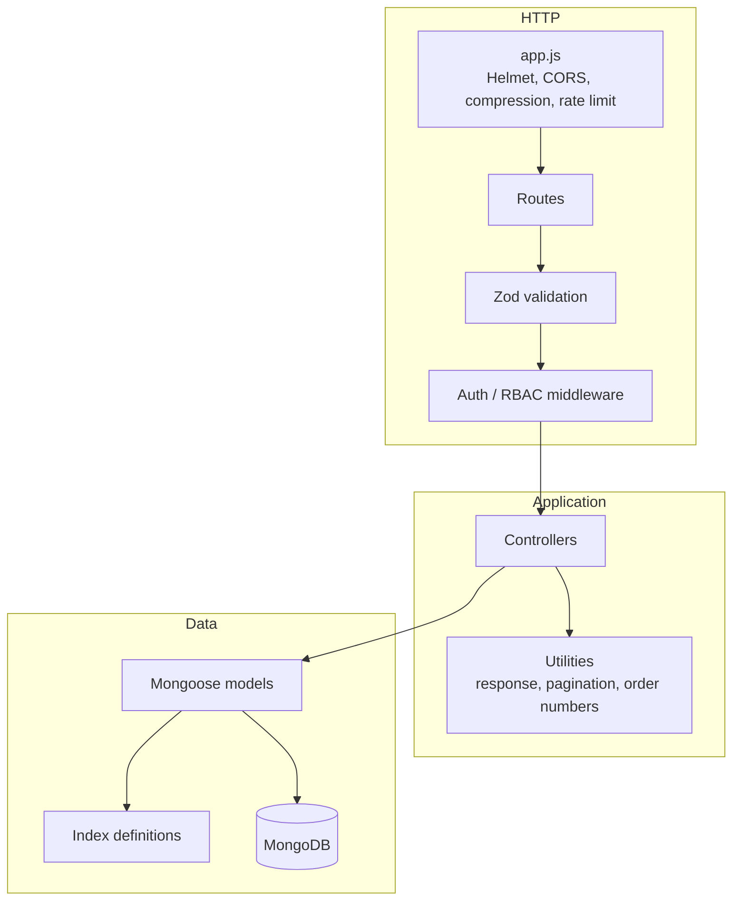
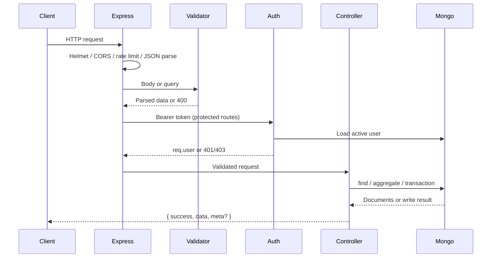
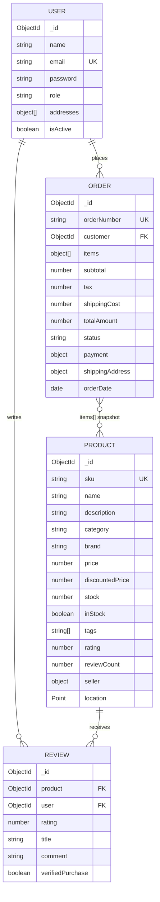
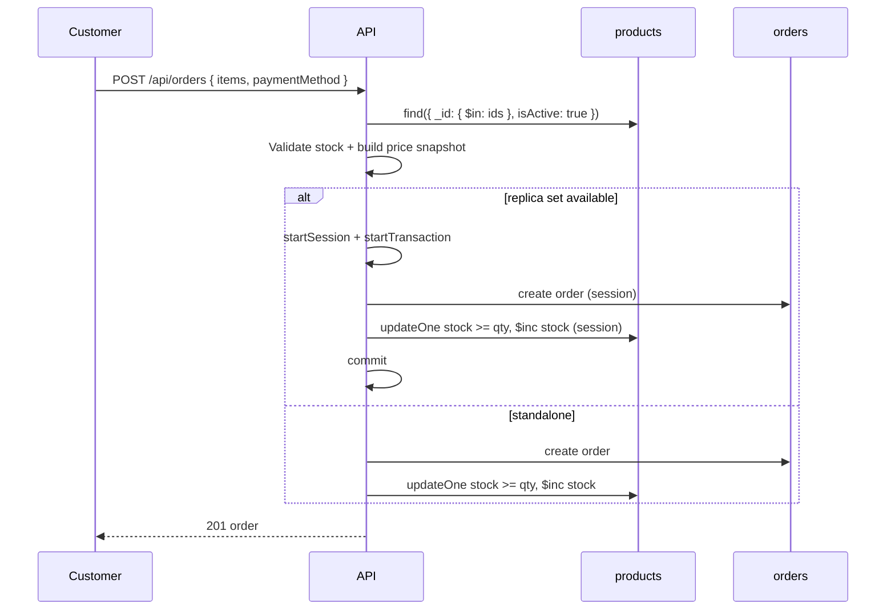

# Architecture

## 1. Goals

The application is a small e-commerce backend designed to exercise the MongoDB features required by the final project:

- document modelling with embedded and referenced data;
- complete CRUD with validation and authorization;
- query patterns that can be served by targeted indexes;
- aggregation pipelines for analytics;
- transactions when running on a replica set;
- operational concerns: backup/restore, replication, deployment, and tests.

The result is intentionally monolithic: one Express service, one MongoDB deployment, and clear internal layers. That keeps the project easy to run and review while still demonstrating production-style practices.

## 2. Layered structure

| Layer | Files | Responsibility |
| --- | --- | --- |
| Bootstrap | `src/server.js` | Connect to MongoDB, start HTTP server, graceful shutdown on SIGINT/SIGTERM |
| HTTP app | `src/app.js` | Security middleware, JSON parsing, rate limiting, Swagger, `/health`, route mounting, 404 and error handlers |
| Routing | `src/routes/` | URL-to-controller mapping and per-route middleware |
| Validation | `src/validators/` | Zod schemas for bodies and query strings |
| Authentication | `src/middleware/auth.js` | JWT verification, user loading, role checks |
| Controllers | `src/controllers/` | Business logic, database access, aggregation |
| Models | `src/models/` | Schemas, validation, hooks, indexes |
| Configuration | `src/config/` | Environment parsing, Mongo connection, OpenAPI document |
| Utilities | `src/utils/` | Response envelope, pagination metadata, order-number generation |
| Operations | `scripts/` | Seed, index sync, benchmark, backup/restore, replica set |

## 3. Request lifecycle

Controllers are wrapped in a promise-aware helper so rejected promises reach the centralized error handler. The handler normalizes:

- Mongoose `ValidationError` → `400`
- Mongoose `CastError` → `400`
- duplicate key (`11000`) → `409`
- JWT errors → `401`
- explicit `err.status` → that status
- everything else → `500`

In non-production environments the stack trace is included in the response; in production it is omitted.

## 4. Data model

### Modelling decisions

**References for identities.** `Order.customer`, `Review.user`, and `Review.product` are references because users, products, and reviews are independent entities with their own lifecycles and access patterns.

**Embedded order items.** Each `items[]` entry stores `product`, `sku`, `name`, `quantity`, `unitPrice`, and `lineTotal`. This is a deliberate snapshot: if a product is renamed, repriced, or deleted later, the historical order still renders correctly. It also lets order reads complete with a single document fetch.

**Embedded seller snapshot.** `Product.seller` stores `{ id, name, rating }`. The id still links to the seller, but catalogue cards avoid a join/populate for the display name.

**Embedded addresses.** Addresses belong to one user and are always read with the profile, so they are embedded.

**Derived product rating.** `Product.rating` and `Product.reviewCount` are denormalized. Every review create/update/delete recomputes them with a `$group` aggregation, keeping catalogue reads single-document while accepting a small write-time cost.

**Order status as an enum.** `pending`, `processing`, `shipped`, `delivered`, `cancelled`, `returned`. Payment status is tracked separately (`pending`, `completed`, `failed`, `refunded`).

## 5. Authentication and authorization

1. `POST /api/auth/register` validates the body, hashes the password with bcrypt (cost 12) in a Mongoose `pre('save')` hook, stores the user, and returns a JWT.
2. The JWT payload is `{ sub: userId, role }`; the secret and expiry come from environment variables.
3. `authenticate()` verifies the token, loads the user, rejects missing/disabled accounts, and attaches a password-free user object to `req.user`.
4. `authorize(...roles)` enforces role access.
5. Resource-level ownership is checked in controllers: customers can only read their own orders; sellers can only update their own products; users can only edit their own profiles; reviews can only be edited by their author (admins bypass ownership checks).

Registration only accepts `customer` or `seller`; `admin` users are created by seeding or an administrative process. Profile updates ignore role/isActive changes from non-admins, closing a privilege-escalation path.

## 6. Order creation and inventory

Key points:

- Prices and totals are computed server-side from the database, never trusted from the client.
- Stock is decremented with a conditional update (`{ stock: { $gte: quantity } }`), which prevents overselling under concurrent requests.
- `supportsTransactions()` checks the `hello` command for `setName` (replica set) or `msg: "isdbgrid"` (sharded cluster). On a standalone server the code falls back to sequential writes, so local development remains usable.
- The generated order number combines a timestamp and randomness; the unique index is the final guard against collisions.

## 7. Query and aggregation strategy

- Listing endpoints always paginate (`page`, `limit`, `skip`) and cap `limit` at 100.
- Product filters map to an index-friendly query shape; sort orders are fixed to values that indexes can support.
- Full-text search uses a compound text index and sorts by `textScore`.
- Geospatial search uses `$near` with a `2dsphere` index and a maximum distance.
- Analytics use server-side aggregation (`$group`, `$bucket`, `$unwind`, `$dateToString`) rather than loading documents into Node.
- `scripts/benchmark.js` compares indexed plans against forced `COLLSCAN` plans with `explain('executionStats')`.

See [indexing.md](indexing.md) for the index catalogue and measured results.

## 8. Failure handling and operations

- **Startup:** the server refuses to start if the initial MongoDB connection fails.
- **Shutdown:** SIGINT/SIGTERM close the HTTP server, then disconnect Mongoose.
- **Unhandled rejection:** logged; uncaught exception exits non-zero so a process manager can restart it.
- **Health check:** `/health` returns process uptime and a timestamp; it is used by the Docker `HEALTHCHECK`.
- **Backups:** logical JSON snapshots with a manifest; restore is a destructive replace intended for drills.
- **Replication:** scripts create a three-node set for local verification; production guidance is in [replication.md](replication.md).

## 9. Trade-offs and extension points

| Decision | Benefit | Cost / next step |
| --- | --- | --- |
| Monolith | Simple to run and reason about | Split into services only when scaling requires it |
| MongoDB text index | Built in, no extra infrastructure | Atlas Search for relevance, fuzzy matching, autocomplete |
| Denormalized rating | Fast catalogue reads | Recompute on review writes; acceptable at this scale |
| Embedded order items | Atomic order reads and historical accuracy | Larger documents for very large baskets |
| JSON backups | Portable, dependency-free | Use `mongodump`/snapshots for large production datasets |
| JWT without refresh tokens | Simple stateless auth | Add refresh-token rotation and revocation for production |
| No payment gateway | Focus stays on MongoDB | Integrate a provider and use idempotency keys |

Potential extensions: cart collection, wishlists, coupon engine, inventory reservations, Atlas Search, change streams for notifications, OpenTelemetry tracing, and a CI pipeline that runs the Jest suite against a MongoDB service container.
