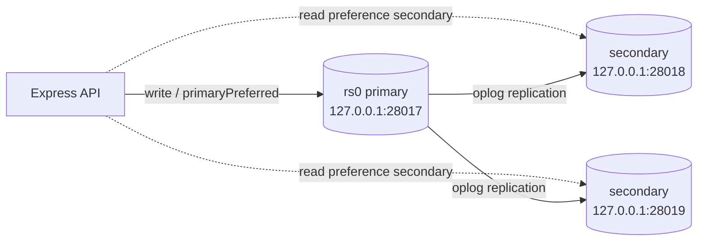

# Replication

## 1. Why replication

A MongoDB replica set keeps multiple copies of the same data:

- **High availability** — if the primary fails, a secondary is elected automatically.
- **Durability** — writes can be acknowledged by a majority of data-bearing members.
- **Read scaling** — read-only workloads can be served from secondaries (with an appropriate read preference).
- **Operational safety** — backups can be taken from a secondary without loading the primary.
- **Transactions** — multi-document transactions require a replica set or sharded cluster.

The application is written so that the same code runs against a standalone server for local development and against a replica set for production behaviour.

## 2. Topology used in this project



| Member | Port | Role | Priority |
| --- | ---: | --- | ---: |
| `rs0` node 1 | 28017 | Primary (preferred) | 2 |
| `rs0` node 2 | 28018 | Secondary | 1 |
| `rs0` node 3 | 28019 | Secondary | 1 |

All three are data-bearing voting members. There is no arbiter, so the set can tolerate one node failure and still elect a primary (2 of 3 majority).

The local scripts store data under `tmp/rs/rs0`, `tmp/rs/rs1`, and `tmp/rs/rs2` (ignored by git).

## 3. Local setup

### Prerequisites

- `mongod` available on `PATH` (or edit `scripts/replica-set-start.ps1` with an absolute path).
- `mongosh` for initiation and status checks.
- Ports 28017, 28018, and 28019 free.

### Start the nodes

```bash
npm run replica:start
```

The PowerShell script creates the data directories and launches three `mongod` processes with `--replSet rs0`, `--bind_ip 127.0.0.1`, and `--oplogSize 64`.

### Initiate the set

```bash
npm run replica:init
```

This runs `mongosh --port 28017 scripts/replica-set-init.js`:

```js
rs.initiate({
  _id: "rs0",
  members: [
    { _id: 0, host: "127.0.0.1:28017", priority: 2 },
    { _id: 1, host: "127.0.0.1:28018", priority: 1 },
    { _id: 2, host: "127.0.0.1:28019", priority: 1 }
  ]
});
```

Wait a few seconds for the election, then check:

```bash
mongosh --port 28017 --eval "rs.status()"
```

Observed result in this environment:

```json
{
  "set": "rs0",
  "members": [
    { "name": "127.0.0.1:28017", "state": "PRIMARY", "health": 1 },
    { "name": "127.0.0.1:28018", "state": "SECONDARY", "health": 1 },
    { "name": "127.0.0.1:28019", "state": "SECONDARY", "health": 1 }
  ]
}
```

### Stop the nodes

```bash
npm run replica:stop
```

## 4. Connection string

```text
mongodb://127.0.0.1:28017,127.0.0.1:28018,127.0.0.1:28019/?replicaSet=rs0
```

Set it in `.env`:

```dotenv
MONGODB_URI=mongodb://127.0.0.1:28017,127.0.0.1:28018,127.0.0.1:28019/?replicaSet=rs0
```

Mongoose/the Node driver will discover the set, route writes to the primary, and follow elections automatically.

## 5. Verifying replication

### Write propagation

Write on the primary:

```bash
mongosh --port 28017 --eval "
  db.getSiblingDB('replica_demo').items.insertOne({
    name: 'replicated-doc',
    createdAt: new Date()
  })
"
```

Read from each secondary:

```bash
mongosh --port 28018 --eval "db.getSiblingDB('replica_demo').items.findOne({}, {_id: 0})"
mongosh --port 28019 --eval "db.getSiblingDB('replica_demo').items.findOne({}, {_id: 0})"
```

Observed on both secondaries:

```json
{ "name": "replicated-doc", "createdAt": "2026-10-29T08:03:20.954Z" }
```

### Failover drill

1. Identify the process listening on 28017 and stop it.
2. Wait roughly 10 seconds for the election.
3. Check status through a surviving member.

Observed after killing the primary:

```json
{
  "primary": "127.0.0.1:28019",
  "members": [
    { "name": "127.0.0.1:28017", "state": "(not reachable/healthy)" },
    { "name": "127.0.0.1:28018", "state": "SECONDARY" },
    { "name": "127.0.0.1:28019", "state": "PRIMARY" }
  ]
}
```

After restarting the old primary with the same data directory, it re-joined and, because it has priority 2, was elected primary again:

```json
{
  "primary": "127.0.0.1:28017",
  "members": [
    { "name": "127.0.0.1:28017", "state": "PRIMARY", "health": 1 },
    { "name": "127.0.0.1:28018", "state": "SECONDARY", "health": 1 },
    { "name": "127.0.0.1:28019", "state": "SECONDARY", "health": 1 }
  ]
}
```

The application reconnects automatically; no code change is required.

### Application tests against the replica set

The full Jest suite was run against the replica set to exercise the transaction path:

```powershell
$env:MONGODB_TEST_URI='mongodb://127.0.0.1:28017,127.0.0.1:28018,127.0.0.1:28019/mongo_final_project_test?replicaSet=rs0'
npm test
```

Result:

```text
Test Suites: 5 passed, 5 total
Tests:       30 passed, 30 total
```

On a standalone server, `createOrder` detects the absence of a replica set and falls back to sequential writes. On the replica set, `supportsTransactions()` sees `setName: "rs0"` in the `hello` reply and runs the order insert plus stock updates in a session transaction.

## 6. Transactions in the application

`src/controllers/order.controller.js`:

```js
async function supportsTransactions() {
  if (mongoose.connection.readyState !== 1) return false;
  const hello = await mongoose.connection.db.admin().command({ hello: 1 });
  return Boolean(hello.setName) || hello.msg === 'isdbgrid';
}

const session = (await supportsTransactions()) ? await mongoose.startSession() : null;
if (session) session.startTransaction();
// Order.create(..., { session })
// Product.updateOne(..., { session })
if (session) await session.commitTransaction();
```

This keeps local development simple (standalone MongoDB is common on student machines) while using the stronger guarantee where it is available. In production, run the app against a replica set and keep transactions enabled.

## 7. Write and read concerns

The project uses driver defaults (`w: 1`, `readPreference: primary`). For production, consider:

```js
// Example production connection options
mongoose.connect(uri, {
  writeConcern: { w: 'majority', j: true, wtimeout: 10000 },
  readConcern: { level: 'majority' },
  readPreference: 'primaryPreferred',
});
```

- `w: 'majority'` acknowledges writes after most data-bearing members persist them.
- `j: true` waits for the journal.
- `readConcern: 'majority'` avoids reading data that could still be rolled back.
- `readPreference: 'secondaryPreferred'` can offload read-only analytics, but may return slightly stale data.

For this assignment's local set, the defaults are sufficient and keep the demos fast.

## 8. Docker alternative

`deploy/docker-compose.replica.yml` defines three MongoDB containers:

```bash
docker compose -f deploy/docker-compose.replica.yml up -d
```

Then initiate from inside one container:

```bash
docker exec -it mongo-rs0 mongosh --eval '
  rs.initiate({
    _id: "rs0",
    members: [
      { _id: 0, host: "mongo1:27017", priority: 2 },
      { _id: 1, host: "mongo2:27017", priority: 1 },
      { _id: 2, host: "mongo3:27017", priority: 1 }
    ]
  })
'
```

The hostnames must match what the containers use to reach each other (`mongo1`, `mongo2`, `mongo3`), not `localhost`. Exposed host ports are 27017, 27018, and 27019.

## 9. Production checklist

- [ ] Use **three data-bearing members** across failure domains (or five for stricter durability).
- [ ] Enable **keyfile or x509 authentication** and internal TLS.
- [ ] Bind to private interfaces; never expose 27017 publicly.
- [ ] Set `writeConcern: majority` for critical writes.
- [ ] Size the **oplog** for the longest expected maintenance/outage window.
- [ ] Monitor replication lag (`rs.printSecondaryReplicationInfo()`), elections, and oplog window.
- [ ] Use `priority` and `hidden`/`delayed` members deliberately for failover and backup policy.
- [ ] Take backups from a secondary with `mongodump --oplog` or filesystem/volume snapshots.
- [ ] Test failover regularly and document RTO/RPO.
- [ ] Do not use arbiters for critical data sets unless you accept reduced durability.

## 10. Troubleshooting

| Symptom | Check |
| --- | --- |
| `no replset config has been received` | Run `rs.initiate(...)` on the intended member |
| Set stays `SECONDARY` with no primary | Wait for election; check member health and majority |
| `NotYetInitialized` | Initiation script was not run or targeted the wrong port |
| `ECONNREFUSED` on 28017 | Node process died; inspect its console/dbpath lock |
| Duplicate data directory error | A previous `mongod` is still using `tmp/rs/rsN`; stop it first |
| Test failures only on replica set | Ensure the URI includes `?replicaSet=rs0` and all three hosts |
| Cannot connect from Docker app | Use container hostnames (`mongo1:27017`), not `127.0.0.1` |
